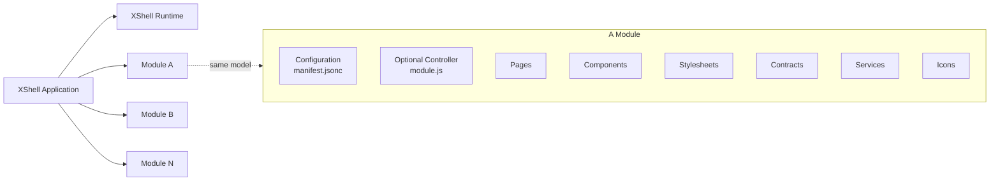

# XShell

**XShell is a browser-native runtime for building modular enterprise web applications that are meant to stay healthy, understandable, and maintainable for years.**

The idea is simple: use the Web Platform first, keep the runtime small, make behavior explicit, and make each module easy to understand on its own.

> **Understanding one module should not require understanding the whole application.**

XShell is not tied to a particular rendering library, build pipeline, or deployment model. Its stable concepts are Modules, resources, Contracts, Pages, Services, Areas, and browser-native URLs.

XShell is currently **pre-1.0** and evolving.

## What XShell is designed for

- **Long-lived enterprise UI**: applications should age well and require as little maintenance as possible.
- **Web Platform first**: ES modules, Web Components, Service Workers, URLs, CSS, `fetch`, and browser APIs are the foundation.
- **Low cognitive load**: years later, an engineer should still be able to open a module and quickly understand what it does.
- **Minimum magic**: important behavior should be visible in code or configuration.
- **Modularity**: applications are composed from independent Modules with stable identities and predictable structure.
- **Portable deployment**: application code uses stable application Paths while XShell maps them to the appropriate resource URLs.
- **Developer friendly**: behavior should be easy to trace from source to browser, with minimal build-time machinery.
- **Understandable by humans and AI**: predictable files, naming, schemas, contracts, and boundaries make the system easy to inspect and reason about.
- **Explicit contracts**: Services, Components, and Pages describe their public properties, methods, and events where practical; Components and Pages also describe slots.
- **Framework agnostic**: XShell is not built around React, Vue, Lit, or any other rendering framework. Its architecture is based on Web standards, and rendering technologies can evolve independently from the application structure.

## How an application fits together

An XShell application is composed from a selected **root module**, its recursively resolved module dependencies, the selected XShell framework,
and host configuration. The root module starts dependency resolution; it is not the whole application. At runtime, bootstrap produces one effective
configuration with three distinct sections:

```js
config = {
    app: {},      // effective application identity, metadata, and hosting context
    modules: {},  // selected and normalized module definitions
    xshell: {}    // framework and subsystem configuration
};
```

A Module can contain Pages, Components, styles, Services, Contracts, icons, and optional module behavior.



A good Module should be easy to inspect and answer:

- What does it provide?
- What does it depend on?
- How is it configured?
- Which resources does it expose?
- Where should I look when something goes wrong?

Sample module file structure:
```
my-module/
├── manifest.jsonc
├── module.js
│
├── pages/
│   ├── index.js
│   ├── customers/
│   │   ├── index.js
│   │   └── detail.js
│   └── settings/
│       └── index.js
│
├── components/
│   ├── customer-card.js
│   ├── customer-form.js
│   └── status-badge.js
│
├── contracts/
│   ├── customer-repository.json
│   └── notification-service.json
│
├── services/
│   ├── customer-repository.js
│   └── notification-service.js
│
├── styles/
│   ├── index.css
│   └── customers.css
│
└── icons/
    ├── customer.svg
    ├── settings.svg
    └── warning.svg
```


## Repository-driven startup

The ASP.NET host emits metadata naming a root reference such as `module:x-demo:latest` and one or more ordered repository index URLs. The host-owned
`bootstrap/index.js` then:

1. loads repository indexes and module version indexes;
2. selects stable module generations and resolves dependencies from version-index metadata;
3. downloads and normalizes the selected manifests;
4. merges the framework, dependencies, dependents, and root into the effective configuration;
5. registers Service Worker mappings for the fixed `/_assets` virtual namespace; and
6. imports the selected framework runtime, freezes the configuration, and calls `xshell.init(config)`.

The browser accepts exact stable versions, `latest`, and fully specified caret or tilde requirements such as `^1.2.3` and `~1.2.3`. Repository
order is precedence: the first repository with a usable compatible generation wins. Dependency discovery uses each selected version entry's
`dependencies`; it does not follow authored `configUrl` references inside downloaded manifests.

Development middleware generates repository and version indexes from the resource tree. It also serves strict-JSON descriptor responses with a
generated physical file inventory while leaving authored `manifest.jsonc` files unchanged.

## Assets and packaging status

The browser maps generation-qualified virtual Paths such as `/_assets/my-module/1.2.3.dev/...` to each selected definition's physical
`assets.url`. Expanded-directory destinations are proxied directly. Destinations whose URL pathname ends in `.zip` are read by the Service Worker;
package bytes use Cache Storage while the durable mapping registry uses IndexedDB.

Reusable packaging code exists for normalized descriptors, inventories, immutable ZIPs, hashing, and publication. Full application packaging is
currently incomplete and still belongs to the previous `configUrl`-driven bootstrap architecture: `Pack.cs` follows authored `configUrl`
references, expects framework `bootstrap.js`, and its root startup generation method throws `NotImplementedException`. Do not treat the current
`pack` command as an implemented repository-driven production deployment workflow. See
[Packaging](src/DProjects.XShell/Resources/DProjects.XShell/xshell-docs/pages/10-architecture/50-packaging.md).


## A few important boundaries

XShell keeps responsibilities intentionally separate:

```text
Resolver        -> decides what a resource means and where it is
Loader          -> obtains or constructs that resource

Contract        -> describes public API
Implementation  -> provides behavior

Property        -> public API
State           -> private reactive data

State engine    -> owns state behavior
Render engine   -> owns rendering

Module          -> reusable package
Area            -> navigation/composition context

Page            -> presentation + lifecycle
Navigation      -> browser URLs and page stacks
```

These boundaries make the runtime easier to understand, change, and debug.

## Components and Pages

XShell uses **Web Components** as its component foundation.

Components may be native custom-element classes or definition objects with a public `contract` and a separate implementation.

Pages share many concepts with Components, but add navigation context and Page lifecycle.

```text
Page = Component model + Navigation context
```

## Browser platform baseline

XShell V0 targets Web Platform capabilities that are **Baseline 2026** or earlier and requires a secure context. Production applications must be
served over HTTPS. XShell does not provide legacy-browser compatibility, browser polyfills, or transpiled/downlevel browser builds; support below
the Baseline 2026 platform target is outside V0. The canonical documentation is
[Browser Platform Baseline](src/DProjects.XShell/Resources/DProjects.XShell/xshell-docs/pages/10-architecture/15-browser-platform.md).

## Modules, Areas, and Navigation

A **Module** owns reusable resources and configuration.

An **Area** composes one or more Modules into a navigation context.

Navigation handles:

- friendly paths and routes
- browser history
- path or hash navigation
- page stacks
- dialogs and embedded Pages
- browser URL generation

Path navigation is preferred when the server provides SPA fallback. Hash navigation remains available when it does not.


## Designed to be debugged

Long-lived software must be easy to diagnose.

XShell favors:

- predictable resource Paths
- stable Module identities
- explicit configuration
- deterministic resource inventories
- clear Resolver / Loader separation
- explicit lifecycle boundaries
- dedicated diagnostics

When something fails, an engineer should be able to follow the path from configuration to resource resolution to loading to runtime behavior.

## Browser first, server where useful

The browser owns the application runtime.

ASP.NET Core currently provides:

- bootstrap generation
- development resource serving
- on-demand compilation
- SPA fallback
- temporary-file handling
- packaging/build tooling

Browser behavior stays in the browser; server and build concerns stay on the server.


## Getting started

XShell currently targets **.NET 10**.

Run the demo:

```bash
dotnet run --project src/DProjects.XShell -- server
```

The cookbook's file explorer uses the in-memory filesystem and needs no hosted share.

## Documentation

The documentation is itself an XShell Module:

```text
src/DProjects.XShell/Resources/DProjects.XShell/xshell-docs/
```

Start here:

```text
src/DProjects.XShell/Resources/DProjects.XShell/xshell-docs/pages/index.md
```

It covers architecture, Components, Pages, subsystems, extensions, specifications, and ADRs.

## Engineering direction

When evolving XShell, prefer:

1. Web Platform capabilities first;
2. explicit behavior;
3. clear ownership;
4. a small core;
5. convention for predictable structure;
6. configuration for real choices;
7. abstraction only when concrete use cases justify it.

A good XShell Module should still be readable years after it was written.

---

> **Build on the browser. Keep the architecture explicit. Make the system easy to understand, debug, and maintain for years.**
