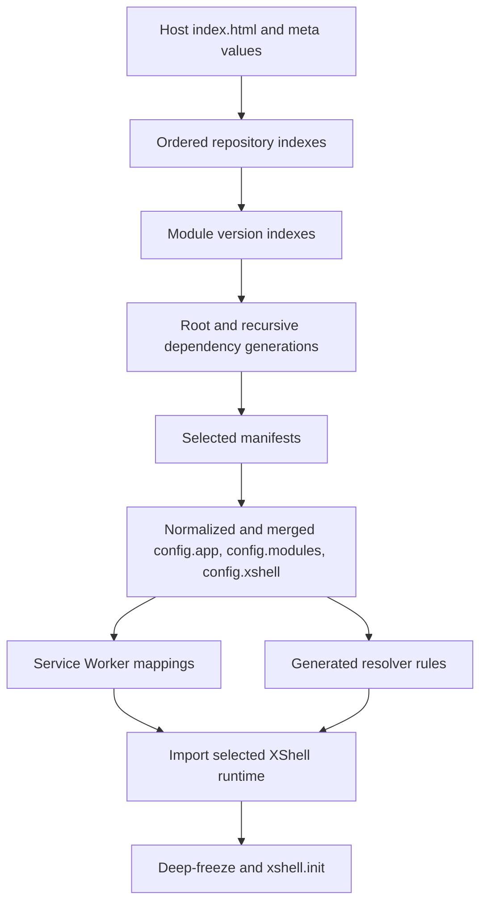

# Bootstrap

The active browser bootstrap is the host-owned `bootstrap/index.js`. The generated host `index.html` loads it directly; startup is not delegated to
a version-specific framework `bootstrap.js`.

## Host inputs

The host supplies these meta values:

```html
<meta name="xshell:app.module" content="module:x-demo:latest">
<meta name="xshell:app.basePath" content="">
<meta name="xshell:app.params" content="">
<meta name="xshell:app.environment" content="Development">
<meta name="xshell:app.source" content="/_resources/DProjects.XShell/index.json">
<meta name="xshell:xshell.temp.url" content="/temp">
```

`xshell:app.source` is repeatable. Source order is repository precedence. The bootstrap normalizes every configured source against
`document.baseURI` and requires its URL to end in `index.json`.

## Startup sequence



```text
host index.html
    -> read host metadata and ordered repository sources
    -> load available repository indexes
    -> resolve the root module reference
    -> load module version indexes and schedule recursive dependencies
    -> validate that each module id selects one generation
    -> download selected manifests
    -> generate asset paths and normalize manifest values
    -> merge XShell, dependencies, dependents, and root
    -> construct config.app and fill framework/resolver defaults
    -> register generated Service Worker mappings
    -> import the selected XShell runtime entry
    -> deep-freeze config and await xshell.init(config)
```

The implementation records a performance checkpoint after each major phase and prints a timing table in `finally`. It shows a delayed spinner while
startup is running. A failure is logged, removes the spinner, and replaces the document body with an application-startup error. Individual
repository and module-index failures are warnings when another source can satisfy the request; a manifest failure after selection is fatal.

## Repository and version resolution

A root or dependency reference has this form:

```text
module:<module-id>:<version-requirement>
```

The browser supports:

- an exact stable `major.minor.patch` version;
- `latest`;
- a fully specified caret requirement such as `^1.2.3`; and
- a fully specified tilde requirement such as `~1.2.3`.

It does not implement `*`, shortened ranges such as `^1.2`, prerelease selection, build-metadata selection, or general npm SemVer expressions.
For each reference, bootstrap examines repositories in configured order and selects the highest compatible stable version from the first repository
with a valid module index and compatible entry.

Repository index:

```json
{
  "modules": {
    "xshell": { "url": "xshell/index.json" },
    "x": { "url": "x/index.json" }
  }
}
```

Module version index:

```json
{
  "module": "x",
  "versions": {
    "1.2.3": {
      "url": "1.2.3.dev/manifest.json",
      "dependencies": {
        "xshell": "module:xshell:^1.0.0"
      }
    }
  }
}
```

Repository-index and version-index requests are deduplicated by URL. Module-resolution requests are deduplicated by the complete reference string,
and selected generations are cached by `<name>@<version>`. After recursion finishes, bootstrap rejects two selected versions or manifest URLs for
the same module id. Dependency graph traversal rejects cycles and missing dependency ids.

The dependency information used for discovery comes from the selected version-index entry. Downloaded manifests contribute configuration, but the
browser does not discover additional packages by following `modules.<id>.configUrl` values inside them.

`ModuleIndexBuilder` accepts full semantic versions, including prerelease and build metadata, when generating indexes. The browser selector is
deliberately narrower and selects only plain stable `major.minor.patch` keys. Repository tooling and browser selectability are therefore distinct.

## Manifest normalization and merge

The selected version entry's `url` must resolve to an HTTP(S) URL whose path ends in `/manifest.json` and has no query or fragment. The downloaded
document must contain `xshell` for the framework or `modules.<selected-id>` for a normal module, with a version equal to the selected index version.

For each selected generation, bootstrap adds effective metadata:

- `configUrl`: the absolute selected manifest URL;
- `assets.url`: the absolute physical directory or ZIP URL, resolved from authored `url:...` and defaulting to `url:./`;
- `assets.path`: `/_assets/<id>/<version>.dev` in Development or `/_assets/<id>/<version>.<hash>` otherwise; and
- `files`: inventory paths normalized into that generation-qualified virtual namespace.

The host currently fixes the effective virtual base to `/_assets`; it does not derive a selectable base from authored configuration. Production
generations require the version-index hash.

Manifest values are normalized recursively. `app:` resolves below the application base URL, `url:` resolves against the selected manifest URL,
absolute schemes remain unchanged, `/` starts at the owning generation's virtual root, and `./` or `../` resolve from the declaring logical path
without escaping that root. Ordinary strings are unchanged.

Merge behavior is deterministic:

| Input | Effective result |
| --- | --- |
| Object + object | Recursive property merge. |
| Array + array | Concatenation in merge order. |
| Scalar or other value | The later value replaces the earlier value. |

The selected framework merges first, then dependencies before their dependents, with the root last. The framework's own
`xshell.resolver.esm.xshell` entry is restored after merging so another manifest cannot replace the selected runtime entry.

## Effective application and runtime handoff

Bootstrap constructs `config.app` from the root module and host values. `config.app` is application metadata and hosting context, not the whole
effective configuration and not a runtime module instance. It contains `id`, `label`, `version`, `copyright`, `icon`, `basePath`, `baseUrl`,
`params`, `sources`, and `environment`. `sources` contains all configured repository URLs in normalized absolute form, including sources that were
unavailable during this startup. Host parameters replace the effective root module's `params` and are also exposed as `config.app.params`.

After filling resolver rules, bootstrap generates one `xshell.serviceWorker.mappings` entry for the framework and one for every effective module.
It registers `<app.basePath>/sw.js`, waits for the worker to control the page, sends `registerMappings`, and waits up to five seconds for the
acknowledgement. A newly installed worker that does not yet control the page causes a reload.

Finally, bootstrap resolves the runtime URL from the selected framework's `resolver.esm.xshell.src`, dynamically imports it, recursively freezes the
effective configuration, and calls:

```js
await xshell.init(config);
```

There is no separate `xshell.validateConfig(config)` call in the host bootstrap. `XShell.init()` creates Resolver and Loader, then calls its own
`validateConfig()` before constructing the remaining runtime subsystems.

See [Configuration](20-configuration.md), [Modules](30-modules.md), [Hosting](40-hosting.md), and [Service Worker](110-service-worker.md).
